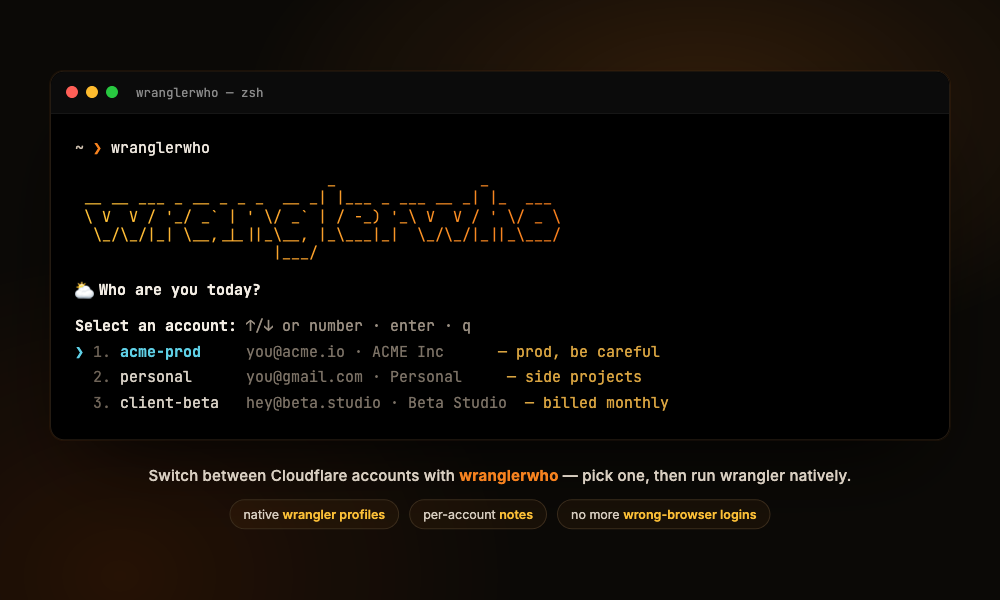

# wranglerwho

<p align="center">
  
</p>

<p align="center">
  <a href="https://www.npmjs.com/package/wranglerwho"></a>
  <a href="https://www.npmjs.com/package/wranglerwho"></a>
  <a href="#requirements"></a>
  <a href="#license"></a>
</p>

Switch between multiple Cloudflare accounts from the terminal — like [`supawho`](https://github.com/EliaTolin/supawho), but for `wrangler`.

```
$ wranglerwho
Pick a Cloudflare account   ↑/↓ or number · enter · q to quit

❯ 1. work        you@company.com · Company Ltd   — prod, be careful
  2. personal    you@gmail.com   · Daze's Account — side projects
  3. client-acme acme@acme.io    · ACME Inc       — invoice monthly

● wrangler is now work (you@company.com) — run wrangler commands; `exit` to leave
work$ wrangler deploy      # targets the "work" account
work$ exit
$
```

## ⚡ Quick start

```sh
# 1. Install (macOS, Linux & Windows — needs Node 18+)
npm install -g wranglerwho

# 2. Log a Cloudflare account in once (opens OAuth, saved as a named profile)
wranglerwho add work

# 3. Pick it, then run wrangler as that account
wranglerwho use work
wrangler deploy      # inside the subshell this targets "work"; `exit` to leave
```

## Why

`wrangler login` opens a browser for OAuth, and when you have many Cloudflare
accounts it's easy to land in the wrong browser profile / container. Juggling
several logins day-to-day is worse.

wranglerwho is a thin front-end over wrangler's **native auth profiles** (beta).
wrangler does the login and credential storage; wranglerwho adds the parts it
doesn't have:

1. **Notes** per account (`— prod, be careful`), stored in `~/.wranglerwho/notes.json`
2. An **interactive picker** (arrow keys or number)
3. A **"switch once" subshell** — pick an account, then run native `wrangler`
   commands normally; `exit` to leave

Switching never re-opens a browser: login happens once per account, at `add` time.

## How it works

- Logins/credentials are wrangler's own: `wrangler auth create / list / delete`.
- Picking an account spawns a subshell with a tiny `wrangler` **shim** first on
  `PATH`. The shim injects `--profile <name>` into every command (and passes
  `auth` / `login` / `logout` straight through, since those don't accept the
  flag). Nothing global is mutated; close the shell and it's gone.
- `wranglerwho` only ever writes `~/.wranglerwho/notes.json` (names + notes +
  cached email). Your tokens stay wherever wrangler keeps them.

## Requirements

- Node.js >= 18
- **wrangler with auth profiles** (beta). Check with `wrangler auth --help` —
  you need `wrangler auth create`. If you only see `wrangler auth token`,
  upgrade: `npm i -g wrangler@latest`.

## 📦 Installation

wranglerwho is a tiny Node CLI — all it needs is **Node.js 18+** and a
**wrangler with auth profiles** (see [Requirements](#requirements)). Every
option below installs the same single CLI.

### 🍎 Homebrew — macOS & Linux

```sh
brew install dazecoop/tap/wranglerwho
```

### 📦 npm — every platform

```sh
npm install -g wranglerwho
```

Or run it without installing:

```sh
npx wranglerwho
```

### 🐧 Install script — macOS & Linux

```sh
curl -fsSL https://raw.githubusercontent.com/dazecoop/wranglerwho/main/install.sh | sh
```

### 🪟 Windows

```powershell
irm https://raw.githubusercontent.com/dazecoop/wranglerwho/main/install.ps1 | iex
```

### From source

```sh
git clone https://github.com/dazecoop/wranglerwho.git
cd wranglerwho
npm link      # or: npm i -g .
```

## 🔄 Keeping it up to date

```sh
npm update -g wranglerwho
```

## Usage

```
wranglerwho                 pick an account, then run wrangler in a subshell
wranglerwho use [name]      same; jump straight to a named account
wranglerwho run <name> -- <wrangler args>   one-shot command as that account
wranglerwho add <name>      log in a new account (wrangler auth create)
wranglerwho ls              list accounts and notes
wranglerwho note <name> [text]   set/edit notes for an account
wranglerwho rm <name>       delete an account (wrangler auth delete)
wranglerwho help
```

Examples:

```sh
wranglerwho add work                 # OAuth login, stored as the "work" profile
wranglerwho note work "prod, be careful"
wranglerwho run work -- deploy       # one deploy as "work", no subshell
wranglerwho                          # pick, then live in a "work" shell
```

## Notes / limitations

- **Labels vs. wrangler names.** wrangler only allows `[A-Za-z0-9_-]` in a
  profile name. wranglerwho lets you use any readable label (e.g.
  `daze@stacked`) and maps it to a safe wrangler id (`daze-stacked`) under the
  hood. You see the label everywhere; `ls` shows the real id in `[brackets]`.
  `use` / `run` / `note` / `rm` accept either the label or the id.
- **`default` is hidden on purpose.** wrangler's reserved `default` profile (the
  global fallback that plain `wrangler login` manages) is not a wranglerwho
  account — it's excluded from the picker/`ls`, and referring to it points you
  back to `wrangler login` / `wrangler logout`.
- **Nested sessions are safe.** Switching accounts from inside an existing
  wranglerwho shell reuses the real wrangler path (via `WRANGLERWHO_REAL`) and
  the shim refuses to add a second `--profile`, so wrangler never receives a
  doubled flag (which crashes it with `name2.toLowerCase is not a function`).
- Native profiles are **OAuth only**. For CI / automation, set
  `CLOUDFLARE_API_TOKEN` as usual — it overrides all profiles (and disables
  profile management while set).
- `wrangler whoami` doesn't accept `--profile`, so inside the subshell
  wranglerwho's shim prints the active profile itself instead of calling the
  real `whoami` (which would report your *default* login, not the session one).
- Profile list parsing is defensive because `wrangler auth list`'s text format
  isn't a stable contract; accounts you add through wranglerwho always show up
  regardless, since their names are recorded in `notes.json`.

## License

MIT
